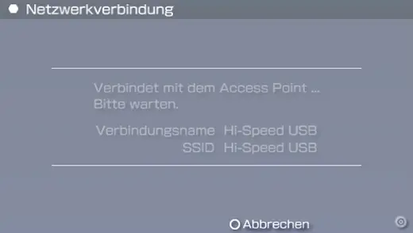
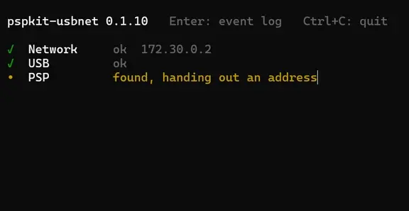
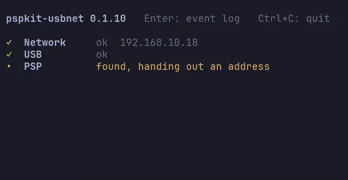

# pspkit-usbnet


**Bring your PSP online over the USB cable** — up to 10x faster than Wi-Fi & works on the PSP Street!

- 🧩 **One plugin**, no flashing needed; use the normal connection menu in apps and games
- ⚡ **Ten times faster** than Wi-Fi (4.8 vs 0.47 MB/s)
- 💻 **Standalone gateway** for Linux, macOS and Windows
- 🛠️ For developers: runs **beside PSPLink** on the same cable
- ✅ Works on the **PSP Street** (E1000)



[Watch the PSP Street XMB recording](assets/connecting-psp.mp4).
The smaller CLI recordings below show the previous 0.1.10 interface.

<table>
<tr><th>Windows</th><th>Linux</th></tr>
<tr>
<td></td>
<td></td>
</tr>
</table>

## 🚀 Get started

**1. PSP:** put [`usbnet.prx`](https://github.com/chriopter/pspkit-usbnet/releases/latest/download/usbnet.prx) into `ms0:/seplugins/` and enable it

**2. PC: run the gateway.** Choose your operating system below. Leave the
gateway window open and connect your PSP with a USB cable.

<details>
<summary><b>Windows</b></summary>

[Download for Windows](https://github.com/chriopter/pspkit-usbnet/releases/latest/download/pspkit-usbnetd-windows-x86_64.exe),
then double-click the downloaded `.exe`.

If a USB driver is needed, the gateway offers to install it. Windows asks
for permission; the gateway explains the local driver certificate first.

</details>

<details>
<summary><b>macOS — Apple Silicon & Intel</b></summary>

[Download for macOS](https://github.com/chriopter/pspkit-usbnet/releases/latest/download/pspkit-usbnetd-macos).
Open Terminal in the download folder and run:

```sh
chmod +x pspkit-usbnetd-macos
./pspkit-usbnetd-macos
```

The download is not Apple-notarized. If macOS blocks its first launch, see
[Apple's instructions for opening downloaded apps](https://support.apple.com/en-us/102445).

</details>

<details>
<summary><b>Linux</b></summary>

[Download for Intel / AMD (x86_64)](https://github.com/chriopter/pspkit-usbnet/releases/latest/download/pspkit-usbnetd-linux-x86_64)
or [ARM64](https://github.com/chriopter/pspkit-usbnet/releases/latest/download/pspkit-usbnetd-linux-aarch64).
Open a terminal in the download folder and run:

```sh
chmod +x pspkit-usbnetd-linux-x86_64
./pspkit-usbnetd-linux-x86_64
```

For ARM64, replace `x86_64` with `aarch64` in both commands.
If USB access needs permission, the gateway asks for your password through
`sudo`.

</details>

**3. PSP, once:** create the connection

Network Settings → Infrastructure Mode → New Connection → Scan → "Hi-Speed USB" → Security: None → save

**4. PSP:** connect with "Hi-Speed USB", like with Wi-Fi

The gateway shows **Connected · 10.77.0.2** once the PSP has its IP address.
In PSPDX, a successful gateway search means the PC is reachable; select the
saved **Hi-Speed USB** connection to go online.

## ⚙️ How it works

The PSP believes it is on Wi-Fi. `usbnet.prx` sits where the WLAN driver would and sends every network packet through the USB cable; the gateway on the PC is its router. **PSPLink keeps a lane of its own in the same cable**, so you can debug and be online at once.

```
        PSP                                        PC
 ┌───────────────────┐                   ┌────────────────────────────┐
 │  game / app       │                   │                            │
 │      │ sockets    │                   │                            │
 │  Sony's network   │                   │                            │
 │      │            │   one USB cable   │                            │
 │  usbnet.prx ══════╪═══ network ═══════╪══► pspkit-usbnetd ══► 🌐   │
 │  usbhostfs  ──────╪─── PSPLink ───────╪──► pspsh, host0:           │
 └───────────────────┘                   └────────────────────────────┘
```

<table>
<tr><th></th><th>Wi-Fi</th><th>USB</th><th>PSPLink</th></tr>
<tr><td><b>App</b></td><td colspan="2" align="center">sockets</td><td></td></tr>
<tr><td><b>System</b></td><td colspan="2" align="center">Sony's stack, unchanged</td><td></td></tr>
<tr><td><b>Driver</b></td><td align="center">WLAN</td><td align="center"><code>usbnet.prx</code></td><td align="center">usbhostfs</td></tr>
<tr><td><b>Link</b></td><td align="center">radio</td><td colspan="2" align="center">one USB cable</td></tr>
<tr><td><b>PC</b></td><td align="center">router</td><td align="center"><code>pspkit-usbnetd</code></td><td align="center"><code>pspsh</code></td></tr>
</table>

## Details

<details>
<summary><b>Notes</b></summary>

- Linux: the gateway needs root for USB and asks for your password itself (sudo); a udev rule for `054c:01c9` does without it
- Windows: the gateway installs the USB driver itself at the first start, Windows asks once for permission (by hand: WinUSB with [Zadig](https://zadig.akeo.ie))
- The PC is a gateway with NAT, like a home router
- One gateway serves up to four PSPs at once, each on its own cable
- DNS is the PC's; `--dns IP` picks another server, or set one in the connection on the PSP
- The connection is an ordinary saved one: edit or delete it like any other
- USB is only taken while connected
- Hold START at power-on to start without plugins
- ARK plugin line: `always, ms0:/seplugins/usbnet.prx, on`
- In the [PSPDX catalog](https://chriopter.github.io/pspdx-catalog/) as a plugin: `usbnet-psp.zip`
- With PSPLink: `pspsh -e "ldstart host0:/usbnet.prx"`
- Options: `alone`, `beside`, `nowlan`

</details>

<details>
<summary><b>For developers</b></summary>

- An app can ask whether the gateway is there, before and without connecting: `sceIoDevctl("usbnet:", command, ...)`
- Nothing to import or link. No plugin, or one from before this: the call fails with `0x80020321` (no such device)
- `1` VERSION: the interface's number, `1`
- `2` STATE, at once, bits: `1` cable in a host (known while USB is active), `2` plugin on the bus, `4` connected over the cable, `8` gateway heard in the last 5 s
- `3` PROBE, in: `u32` time in ms (up to 10000): returns `1` gateway there, `0` not there, as soon as it knows
- PROBE errors: `-1` cable not in a host, `-2` USB storage has the port, `-3` plugin unloading, `-4` unknown command or argument
- PROBE takes USB while it looks and gives it back, unless a connection has it; a connection that is up is not disturbed. With 0 ms it does not look: `1` if the gateway was heard in the last 5 s
- It blocks: call it from a thread of its own if the screen has to keep drawing
- With the gateway running the answer takes one to two seconds, 20 ms while the plugin is on the bus (connected, or beside PSPLink)
- The numbers as a header: [`psp/usbnet_api.h`](psp/usbnet_api.h); a test: [`tests/probe`](tests/probe)

```c
unsigned ms = 6000;
int there = sceIoDevctl("usbnet:", 3, &ms, sizeof ms, NULL, 0);
if (there == 1)                 { /* connect: the gateway answers */ }
else if (there == 0x80020321)   { /* no plugin, or an old one: ask the user */ }
else                            { /* not there (0), or why it could not look (< 0) */ }
```

</details>

<details>
<summary><b>Tested</b></summary>

The scope and results of the 1.0 verification are recorded in
[`tests/release-1.0.md`](tests/release-1.0.md). Historical hardware results
below do not replace testing the current binaries.

- Gateway 1.0.0: 30 local tests; 17 unit and 10 protocol tests also executed in Windows 11, plus actual binary startup and installer success/failure cleanup in an isolated VM
- Current Linux gateway beside the Street's XMB and PSPLink: 20 of 20 gateway probes, two concurrent callers each, responses in 20–21 ms; PSPLink remained available
- PSP-1000 and PSP Go, 6.60 + ARK, Linux gateway
- PSP Street (E1000), ARK + PSPLink, Linux gateway: saved USB profile, DHCP, 10 MiB download with matching checksum, five short TCP requests, twenty UDP echoes, DNS and an internet HTTP request (200 OK). The original game-side infrastructure chooser lists the profile and connects successfully (result 0, IP 10.77.0.2). Plugin installed, enabled and automatically loaded after a manual boot.
- From the XMB: connection made from the scan, connection test, a DNS server set by hand
- SOCOM: Fireteam Bravo 2 online (PSRewired): a round played
- PSPDX: first start over the cable, catalog and installs (PSP-1000 and PSP Go)
- Earlier releases beside PSPLink: 80 of 80 downloads intact, 210 of 210 connects
- Windows gateway 0.1.10: Windows 11 in a VM with the PSP-1000 passed through: the gateway installed the driver itself (PSP alone or beside PSPLink, either one first), 20 of 20 downloads intact at 4.6 MB/s, found again after a power cycle
- Native CI executes the release binaries on Linux x86_64/ARM64, Windows x86_64 and macOS Intel/Apple Silicon. USB hardware availability differs by runner.
- Not hardware-tested for 1.0: Windows USB binding, macOS USB connections, Windows 10 and two PSPs at once.

</details>

<details>
<summary><b>Development</b></summary>

```
make -C psp
cargo build --release --manifest-path gateway/Cargo.toml
./release.sh
```

| | |
|---|---|
| `psp/` | the plugin |
| `gateway/` | the gateway, `pspkit-usbnetd` |
| `tests/` | test program and soak scripts |

Street XMB menu work: [`tests/xmb-menu.md`](tests/xmb-menu.md) documents the
guarded RAM change that enables the original Network Settings item. PC-tested
against the 6.61 menu layout; the original entry and its icon are confirmed
visible on a real Street after a normal firmware return to the XMB.

</details>

<details>
<summary><b>Credits</b></summary>

- [PSPLink](https://github.com/pspdev/psplinkusb): model for the USB code, BSD ([licence](THIRD_PARTY_PSPLINK_LICENSE))
- [libusb](https://libusb.info): inside the gateway, LGPL 2.1 ([licence](THIRD_PARTY_LIBUSB_LICENSE))
- [JPCSP](https://github.com/jpcsp/jpcsp): first map of the WLAN interface
- pspkit-usbnet is MIT

</details>
